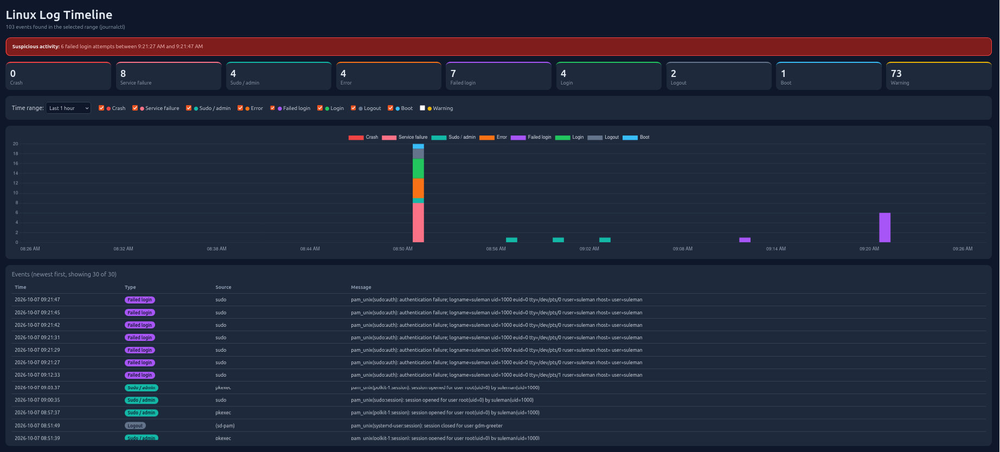

# Linux Log Timeline

A lightweight web tool that reads Linux system logs (`journalctl`) and turns them into a visual timeline of errors, service failures, logins, admin (sudo) activity, and boots. It also flags bursts of failed logins as suspicious activity.



## Features
- Reads logs directly from `journalctl` (JSON output)
- Classifies events: service failure, crash, error, failed login, login, logout, sudo/admin, boot
- Stacked timeline chart with time ranges (1h, 6h, 24h, 7d)
- Filter events by type; noisy warnings are hidden by default
- Alert banner when 3 or more failed logins happen within 5 minutes

## Tech Stack
Python, Flask, JavaScript, Chart.js

## How to Run
```bash
git clone https://github.com/muhammadsuleman23/log-timeline.git
cd log-timeline
python3 -m venv venv
source venv/bin/activate
pip install -r requirements.txt
python app.py
```
Then open `http://127.0.0.1:5001` in your browser.

Your user needs permission to read the journal (members of the `adm` or `systemd-journal` group, which is the default for the first Ubuntu user).

## Demo Note
The failed logins in the screenshot were generated intentionally on my own virtual machine by entering wrong `sudo` passwords, to test the alert detection. They are not a real attack.

## Security Notes
- The server binds to `127.0.0.1` only, because logs can contain private information.
- Log text is rendered as plain text in the browser, never as HTML.

## Future Improvements
- Auto-refresh and live log streaming
- Support for remote servers
- Email/Telegram notifications for alerts
- Docker deployment

## Author
Muhammad Suleman
